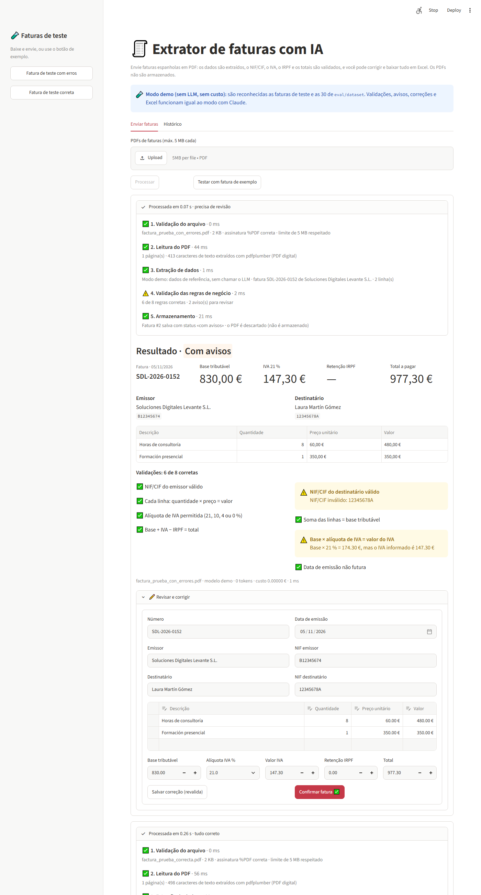
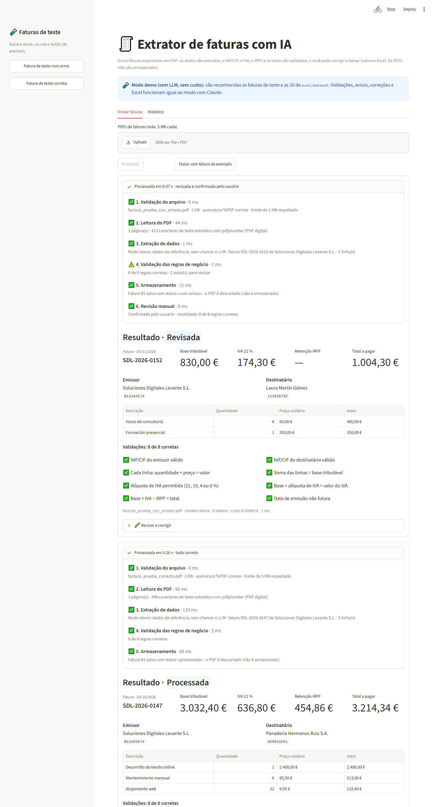

# 🧾 Extrator de faturas com IA

[](https://github.com/falcao27/extractor-facturas/actions/workflows/ci.yml)


Serviço que recebe o PDF de uma fatura espanhola, extrai os dados com um LLM (Claude),
**valida NIF/CIF, IVA, IRPF e totais** com regras de negócio e exporta tudo para Excel.

**Demo:** _[link do Render]_ · **API:** `/docs` (Swagger automático)

| Fatura com avisos | Depois de corrigir e confirmar |
|---|---|
|  |  |

A interface mostra cada etapa do processamento (validação do arquivo, leitura do PDF,
extração, regras de negócio, armazenamento e revisão manual) e o resultado com o checklist
das validações.

## O problema

Pequenas empresas e escritórios de contabilidade na Espanha recebem centenas de faturas em
PDF, com layouts diferentes, e digitam tudo à mão no sistema contábil. Um LLM consegue
ler essas faturas, mas **erra**: este projeto não confia cegamente no modelo. Cada resultado
passa pelas regras fiscais, e a **precisão é medida** num conjunto de teste.

## O que é extraído

Número, data de emissão, emissor e destinatário (razão social + NIF/CIF), linhas (descrição,
quantidade, preço unitário, valor), base tributável (*base imponible*), alíquota de IVA
(21/10/4/0 %), valor do IVA (*cuota*), retenção de IRPF e total.

## Regras de validação

Cada regra gera um **aviso** (não bloqueia): o usuário revisa e corrige.

| Regra | Detalhe |
|---|---|
| NIF / NIE | 8 dígitos módulo 23 → letra de controle (NIE: X/Y/Z → 0/1/2) |
| CIF | letra inicial + 7 dígitos + dígito ou letra de controle |
| Linhas | Σ valores = base tributável; quantidade × preço = valor |
| IVA | base × alíquota / 100 = valor do IVA; alíquota ∈ {21, 10, 4, 0} |
| Total | base + IVA − IRPF = total |
| Data | a emissão não pode estar no futuro |

As contas usam `Decimal`, com tolerância de 0,02 €.

## Avaliação

`eval/generate_invoices.py` gera 30 faturas fictícias com Faker (`es_ES`) e reportlab, cada
uma com seu JSON de referência (gabarito): **3 layouts** (um com formato espanhol `1.234,56`),
com e sem IRPF, de 1 a 10 linhas, **4 escaneadas** (página rasterizada e levemente girada,
sem camada de texto, enviada ao modelo como imagem) e **3 armadilhas** (NIF inválido ou
total errado).

`eval/run_eval.py` compara campo a campo (texto normalizado, números com tolerância de 0,01)
e guarda as respostas em cache para não pagar duas vezes pela mesma fatura.

```bash
python -m eval.run_eval --models claude-haiku-5-5 claude-sonnet-5-5
```

<!-- RESULTADOS: substituir pelo conteúdo de eval/results.md -->
| Campo | claude-haiku-5-5 | claude-sonnet-5-5 |
|---|---:|---:|
| NIF emissor | _pendente_ | _pendente_ |
| Base tributável | _pendente_ | _pendente_ |
| Total | _pendente_ | _pendente_ |
| Custo médio por fatura | _pendente_ | _pendente_ |

## Arquitetura

```
PDF ─► FastAPI (valida: só PDF, ≤ 5 MB, limite por IP)
        │
        ├─► pdfplumber ── texto ──────────┐
        │     └─ < 50 caracteres → PNG ───┤
        │                                 ▼
        │                 Claude · saída estruturada (schema Pydantic)
        │                                 │
        ├─► regras de negócio (NIF, IVA, IRPF, totais, data) → avisos
        ├─► PostgreSQL (dados, avisos JSONB, modelo, tokens, custo, tempo)
        └─► Excel (pandas + openpyxl)          Streamlit ◄─ revisão e correção
```

| Camada | Ferramenta |
|---|---|
| API | FastAPI + Uvicorn |
| Schema | Pydantic v2 (o mesmo modelo para o LLM, a API e a avaliação) |
| LLM | API da Anthropic, `messages.parse` com saída estruturada |
| PDF | pdfplumber (texto) e renderização em PNG para escaneados |
| Banco de dados | PostgreSQL + SQLAlchemy 2 + Alembic |
| Interface | Streamlit |
| Qualidade | Pytest (cobertura > 90 %), Ruff, GitHub Actions, logs em JSON |
| Infra | Docker Compose, Render |

**Decisões:**

- **Saída estruturada** em vez de pedir JSON no prompt: o servidor garante que a resposta
  segue o schema, e o Pydantic valida de novo. As novas tentativas só cobrem
  `refusal`/`max_tokens`; o SDK já repete timeouts, 429 e 5xx.
- **`float` no schema do LLM e `Decimal` nas contas**, para não depender de como cada
  provedor serializa decimais.
- **Os PDFs não são armazenados**: são processados em memória, e só os dados extraídos são
  gravados (LGPD/RGPD).
- O código e as rotas usam os termos espanhóis do domínio (`factura`, `base_imponible`),
  porque as faturas e o prompt do modelo são em espanhol; a interface e as mensagens são em
  português.

## API

| Método | Rota | Descrição |
|---|---|---|
| POST | `/facturas` | Envia um PDF: extrai, valida, grava e devolve o JSON com etapas e avisos |
| GET | `/facturas` | Lista paginada, com filtros por emissor (nome ou NIF) e período |
| GET | `/facturas/{id}` | Detalhe |
| PATCH | `/facturas/{id}` | Correção manual (revalida); `confirmar: true` → `revisada` |
| GET | `/facturas/export.xlsx` | Excel com abas de faturas e de linhas |
| GET | `/health` | Status da API e do banco |

Status: `procesada`, `con_avisos`, `revisada`, `error`.

## Como rodar

### Docker (recomendado)

```bash
cp .env.example .env      # preencha ANTHROPIC_API_KEY
docker compose up --build
```

- Interface: http://localhost:8501
- API e documentação: http://localhost:8000/docs

### Local

```powershell
py -3.12 -m venv .venv
.venv\Scripts\activate                # Linux/macOS: source .venv/bin/activate
pip install -e ".[dev]"
copy .env.example .env                # preencha ANTHROPIC_API_KEY e DATABASE_URL
alembic upgrade head
uvicorn app.main:app --reload
streamlit run ui/streamlit_app.py     # em outro terminal
```

### Modo demo (sem chave nem créditos)

Com `LLM_PROVIDER=demo`, o LLM não é chamado: a API reconhece as faturas de `ejemplos/` e
de `eval/dataset` pelo hash e devolve os dados de referência. Todo o resto é real: leitura
do PDF, validações, avisos, banco, correção e Excel.

```powershell
$env:LLM_PROVIDER="demo"; $env:DATABASE_URL="sqlite:///local.db"
alembic upgrade head
uvicorn app.main:app                  # e em outro terminal: streamlit run ui/streamlit_app.py
```

Teste com `ejemplos/factura_prueba_con_errores.pdf` (NIF inválido e IVA calculado errado)
ou `ejemplos/factura_prueba_correcta.pdf`. As duas também estão na barra lateral.

### Testes e qualidade

```bash
ruff check .
pytest --cov                          # o LLM é simulado: os testes não gastam créditos
python -m eval.generate_invoices      # regenera o dataset (determinístico, seed 42)
```

## Deploy no Render

O `render.yaml` define a API, a interface e o PostgreSQL. No Render: **New → Blueprint →**
este repositório. Depois, preencha `ANTHROPIC_API_KEY` na API (ou use `LLM_PROVIDER=demo`)
e `API_URL` na interface.

> No plano gratuito do Render, o serviço dorme após 15 minutos sem uso: a primeira
> requisição pode levar ~1 minuto. A demo limita 20 faturas por IP por dia para proteger
> os créditos.

## Privacidade

Todas as faturas do repositório são **fictícias**, geradas com Faker. Os PDFs enviados são
processados em memória e **nunca são armazenados**; só os dados extraídos ficam no banco.
Não envie faturas reais para a demo pública.

## Próximos passos

- Fila de processamento (Celery/RQ) e Batch API para milhares de faturas por dia
- Cache por hash do PDF para não reprocessar duplicadas
- Autenticação e múltiplos usuários
- Exportação para formatos contábeis (A3, Contaplus) e Facturae/VeriFactu

## Licença

MIT © Jefferson Falcão
